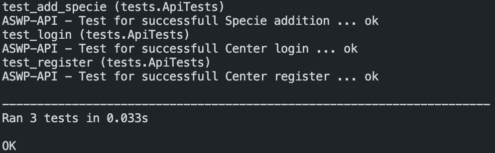

# ASWP-API 
Flask REST API for Animals Sales Web Project

**✅ HTTP Standards Compliant**: This API now follows proper REST conventions - GET requests don't include request bodies and are fully browser-compatible.


# Project setup
Instructions on how to start the API

## Python
To start this project you need ```python>=3.9```

## Virtual environment
Create and activate virtual environment for the project
```sh
# Create virtual environment
python3 -m venv .venv

# Activate virtual environment (Linux/macOS)
source .venv/bin/activate

# Activate virtual environment (Windows)
# .venv\Scripts\activate
```

## Requirements
Install project requirements from ```requirements.txt``` file using ```pip```
```sh
pip install -r requirements.txt 
```

## Configuration
The API uses SQLite database by default. Configuration is stored in `api/config.ini`.

### CORS Configuration
CORS (Cross-Origin Resource Sharing) is configured in `api/config.ini`:

```ini
[CORS]
; Allowed origins for CORS (comma-separated)
; Use * for all origins in development, specific domains for production
ORIGINS = http://localhost:3000,http://localhost:8000,http://127.0.0.1:3000,http://127.0.0.1:8000,http://localhost:5000,http://127.0.0.1:5000
; Set to true to support credentials (cookies, authorization headers)
SUPPORTS_CREDENTIALS = true

[WEBSERVER]
; Configuration for the HTML file server
HOST = 127.0.0.1
PORT = 8000
```

**For Production**: Replace the ORIGINS with your actual domain(s):
```ini
ORIGINS = https://yourdomain.com,https://www.yourdomain.com
```

## Testing
Test if code is working properly in your new environment

```sh
cd api
python -m unittest -v tests.py
```

Successful testing result example



## Starting the Application

### 1. Start the API Server
```sh
cd api
python main.py
```

Or using Flask CLI:
```sh
cd api
export FLASK_APP=main.py
flask run
```

The API will be available at: `http://127.0.0.1:5000`

### 2. Start the Frontend Web Server
In a **separate terminal**, run the web server to serve the HTML interface:

```sh
python webserver.py
```

The frontend will be available at: `http://127.0.0.1:8000`

**Or** you can open `index.html` directly in your browser (may have CORS limitations).

### 3. Testing with Different Tools

- **Browser**: Visit `http://127.0.0.1:8000` for the web interface
- **Postman**: Use `http://127.0.0.1:5000` as the base URL for API calls
- **cURL**: Direct API calls to `http://127.0.0.1:5000`

## CORS Support

✅ **Fully CORS-enabled** for:
- Local development (localhost, 127.0.0.1)
- Browsers with credentials support
- Postman and other API testing tools
- Production deployments (configure origins in `config.ini`)

# API routes and usage examples
Here you can find list of routes and usage examples with Python 3 and ```requests``` library for this API 

## List

| Method 	|          Route          	|                Description               	|     Auth Required    	|
|:------:	|:------------------------	|:----------------------------------------:	|:-------------------:	|
|   GET  	| ```/animals```          	|         Get full list of animals         	|         No          	|
|   GET  	| ```/animals/<int:id>``` 	| Get detailed information about an animal 	|         No          	|
|   GET  	| ```/centers```          	|         Get full list of centers         	|         No          	|
|   GET  	| ```/centers/<int:id>``` 	| Get detailed information about an center 	|         No          	|
|   GET  	| ```/species```          	|         Get full list of species         	|         No          	|
|   GET  	| ```/species/<int:id>``` 	| Get detailed information about an specie 	|         No          	|
|  POST  	| ```/login```            	|               Get JWT token              	|         No          	|
|  POST  	| ```/register```         	|            Register new center           	|         No          	|
|  POST  	| ```/animals```          	|             Create new animal            	|        Yes          	|
|  POST  	| ```/species```          	|             Create new specie            	|        Yes          	|
|   PUT  	| ```/animals/<int:id>``` 	|               Update animal              	|        Yes          	|
| DELETE 	| ```/animals/<int:id>``` 	|               Delete animal              	|        Yes          	|

## Examples
### POST Requests

#### Center login
```python
import requests

url = "http://127.0.0.1:5000/login"

payload = {
    "login": "your_login",
    "password": "your_password"
}
headers = {
    'Content-Type': 'application/json'
}

response = requests.post(url, json=payload, headers=headers)
print(response.text)
```

#### Center register
```python
import requests

url = "http://127.0.0.1:5000/register"

payload = {
    "login": "new_login",
    "password": "new_password",
    "name": "Center Name",
    "address": "Center Address"
}
headers = {
    'Content-Type': 'application/json'
}

response = requests.post(url, json=payload, headers=headers)
print(response.text)
```

#### Add animal (requires JWT token)
```python
import requests

url = "http://127.0.0.1:5000/animals/"

payload = {
    "name": "Animal Name",
    "specie": 1,
    "age": 5,
    "price": 500.50
}
headers = {
    'Content-Type': 'application/json',
    'Authorization': 'Bearer YOUR_JWT_TOKEN_HERE'
}

response = requests.post(url, json=payload, headers=headers)
print(response.text)
```

#### Add specie (requires JWT token)
```python
import requests

url = "http://127.0.0.1:5000/species"

payload = {
    "name": "Specie name",
    "price": 123.0,
    "description": "Specie description"
}
headers = {
    'Content-Type': 'application/json',
    'Authorization': 'Bearer YOUR_JWT_TOKEN_HERE'
}

response = requests.post(url, json=payload, headers=headers)
print(response.text)
```

### GET Requests

#### Full list of animals
```python
import requests

url = "http://127.0.0.1:5000/animals/"

response = requests.get(url)
print(response.text)
```

#### Animal by ID
```python
import requests

url = "http://127.0.0.1:5000/animals/1"

response = requests.get(url)
print(response.text)
```

#### Full list of centers
```python
import requests

url = "http://127.0.0.1:5000/centers"

response = requests.get(url)
print(response.text)
```

#### Center by ID
```python
import requests

url = "http://127.0.0.1:5000/centers/1"

response = requests.get(url)
print(response.text)
```

#### Full list of species
```python
import requests

url = "http://127.0.0.1:5000/species"

response = requests.get(url)
print(response.text)
```

#### Specie by ID
```python
import requests

url = "http://127.0.0.1:5000/species/1"

response = requests.get(url)
print(response.text)
```

### PUT Requests
#### Update animal (requires JWT token)
```python
import requests

url = "http://127.0.0.1:5000/animals/1"

payload = {
    "name": "Updated animal name"
}
headers = {
    'Content-Type': 'application/json',
    'Authorization': 'Bearer YOUR_JWT_TOKEN_HERE'
}

response = requests.put(url, json=payload, headers=headers)
print(response.text)
```

### DELETE Requests
#### Delete animal (requires JWT token)
```python
import requests

url = "http://127.0.0.1:5000/animals/1"

headers = {
    'Authorization': 'Bearer YOUR_JWT_TOKEN_HERE'
}

response = requests.delete(url, headers=headers)
print(response.text)
```

## Authentication Flow

1. **Register** a new center using `/register` (POST)
2. **Login** using `/login` (POST) to get JWT token
3. Use the JWT token in `Authorization: Bearer <token>` header for protected endpoints

## Error Handling

The API returns appropriate HTTP status codes:
- `200`: Success
- `401`: Unauthorized (invalid credentials or missing/invalid JWT)
- `403`: Forbidden (not authorized to perform action)
- `404`: Resource not found
- `409`: Conflict (e.g., login already exists)

## Development Notes

- Database: SQLite (development) - located at `api/database.sqlite`
- Logs: Written to `api/ASWP-API.log`
- JWT tokens are required for creating, updating, and deleting resources
- Centers can only modify their own animals